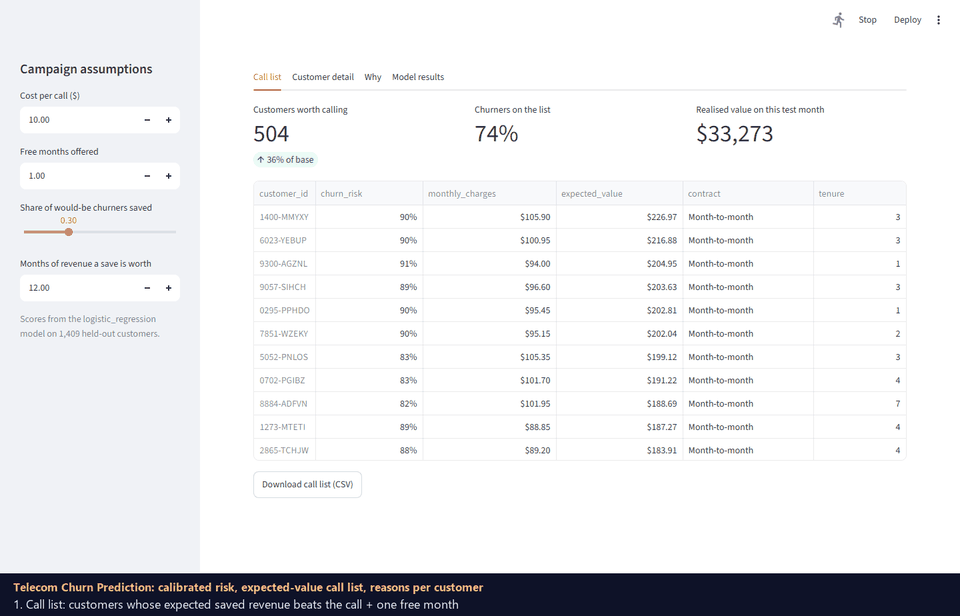

# Telecom churn prediction

Predicts which mobile/broadband customers are likely to leave, explains why for each one, and turns the
scores into a call list a retention team can act on: call a customer only when the expected saved revenue
beats the cost of the call and the offer.

Data: the public [IBM Telco Customer Churn](https://github.com/IBM/telco-customer-churn-on-icp4d) dataset,
7,043 customers, 26.5% of whom left in the last month.

## Demo



## Results (held-out test set, 1,409 customers)

| | Logistic regression (champion) | LightGBM |
|---|---|---|
| ROC-AUC | 0.840 | 0.837 |
| PR-AUC | 0.654 | 0.633 |
| Lift in top 10% | 2.73 | 2.75 |
| Calibration error (ECE) | 0.028 | 0.037 |

The champion is chosen on the validation set by PR-AUC. LightGBM is not better here: the paired bootstrap
95% interval for its PR-AUC gain is [-0.040, -0.004], and for ROC-AUC [-0.008, +0.004]. With 20 mostly
categorical columns and 4k training rows, the relationships are close to additive, so the simpler,
more explainable model wins.

Campaign value on the same test customers (assumptions below):

| Policy | Customers called | Churners reached | Value |
|---|---|---|---|
| Call nobody | 0% | 0% | $0 |
| Call everyone | 100% | 100% | -$3,654 |
| Top 10% by risk | 10% | 27% | $16,780 |
| Top 20% by risk | 20% | 49% | $26,740 |
| **Positive expected value** | 36% | 74% | **$33,273** |

Calling everyone loses money because loyal customers take the free month too. The expected-value rule lands
within 1% of the best possible cut-off on this data ($33,586 at 36%).

Survival analysis (Kaplan-Meier by contract, log-rank p < 1e-10): 70% of month-to-month customers are still
there after 12 months, against 99% on one-year and 100% on two-year contracts.

## Campaign assumptions

`EV = p(churn) x save_rate x horizon x monthly_charges - (contact_cost + incentive_months x monthly_charges)`

contact cost $10, one free month as the incentive, 30% of would-be churners saved, a save is worth
12 months of charges. These are illustrative numbers; change them in `churn/config.py` or live in the app.

## Run it (Windows PowerShell)

```powershell
git clone https://github.com/GrandhiPadmavathi/telecom-churn-prediction.git
cd telecom-churn-prediction
python -m venv .venv
.\.venv\Scripts\python.exe -m pip install -r requirements.txt
.\.venv\Scripts\python.exe scripts\download_data.py
.\.venv\Scripts\python.exe -m churn.train      # writes artifacts/, reports/metrics.json, reports/figures/
.\.venv\Scripts\python.exe -m pytest -q        # 21 tests
.\.venv\Scripts\streamlit.exe run app.py       # http://localhost:8501
```

## Layout

| Path | What it does |
|---|---|
| `churn/config.py` | Paths, seed, campaign economics (`Campaign.expected_value`) |
| `churn/data.py` | Load the CSV, fix blank `TotalCharges`, yes/no to 0/1 |
| `churn/features.py` | Engineered signals + one-hot columns; gender is excluded |
| `churn/models.py` | Logistic regression and LightGBM, calibration choice, per-feature contributions |
| `churn/metrics.py` | PR-AUC, lift/recall at top k, calibration error, paired bootstrap |
| `churn/campaign.py` | Call-list policies and the value curve |
| `churn/explain.py` | Plain-English top reasons per customer |
| `churn/survival.py` | Kaplan-Meier and log-rank test, written by hand |
| `churn/plots.py`, `churn/train.py` | Figures and the end-to-end run |
| `app.py` | Streamlit retention desk: call list, customer reasons, charts |

## Limits

- One snapshot: "churned" means left in the last month, and earlier leavers are not in the data, so the
  survival curves describe the customers who were still here at the snapshot.
- Save rate and offer cost are assumptions, not measured. A real rollout needs a holdout test (call half the
  list) to measure the true save rate before trusting the dollar figures.
- Gender is not a model input; the audit in `metrics.json` shows similar contact rates (38% vs 34%) and the
  same share of churners reached (74%) for both groups.
